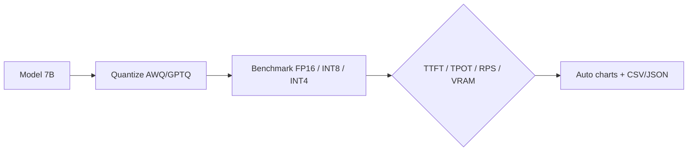

# llm-quant-benchmark

Reproducible quantization benchmark for LLM inference: **FP16 vs. INT8 vs. INT4**
on a 7B model (e.g. Qwen2.5-7B) using **AWQ / GPTQ**, measuring TTFT, TPOT,
throughput, and VRAM footprint with automated scripts and charts.

> **Status:** project in progress — target model and numbers TBD; scripts scaffolding below.

## Background

Quantization trades a small accuracy loss for large reductions in memory and
compute. For inference serving, the questions that matter are: how much VRAM
frees up, how much faster Decode becomes (INT4 kernels), and what TTFT/TPOT/throughput
look like under load. This repo answers them with a repeatable harness.

## Approach



1. Deploy the model with and without quantization.
2. Drive a fixed request workload (concurrent, varied prompt/seq lengths).
3. Record TTFT, TPOT, tail latency, throughput (RPS), peak VRAM.
4. Emit normalized CSV/JSON + matplotlib charts.

## Results (TBD — replace with measured)

| Config | TTFT (ms) | TPOT (ms) | Throughput (RPS) | Peak VRAM |
|--------|-----------|-----------|------------------|-----------|
| FP16   | — | — | — | — |
| INT8 (AWQ) | — | — | — | — |
| INT4 (AWQ) | — | — | — | — |
| INT4 (GPTQ) | — | — | — | — |

- [ ] VRAM vs. speed comparison chart
- [ ] per-config latency distribution (P50 / P95 / P99)

## Reproduction

```bash
pip install -r requirements.txt
python run_bench.py --model Qwen2.5-7B --configs fp16,int8,int4 \
    --concurrency 8 --seq-len 2048
```

Outputs written to `results/` (CSV/JSON + PNG charts).

## Layout

```
run_bench.py      benchmark driver
scripts/          quantization + serving helpers
results/          outputs (charts, CSV, JSON)
```

## Reference

- AWQ: "AWQ: Activation-aware Weight Quantization for LLM Compression and Acceleration"
- GPTQ: "GPTQ: Accurate Post-Training Quantization for Generative Pre-trained Transformers"
